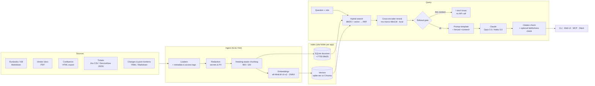

# itops-rag

**Retrieval-augmented answers for IT operations, built the way an IT systems engineer would want it:** cited
answers from runbooks, KB articles, past tickets, change records, post-mortems and vendor docs; hybrid search
that finds error codes like `AADSTS53003` and `0x80180014`; local embeddings and reranking (no per-query cost);
"I don't know" instead of guesses; and an MCP server so Claude Code and other agents can use the same knowledge.

[](https://github.com/chamu262/itops-rag/actions/workflows/ci.yml)


> **Sanitized demo of private production work.** Everything in `data/demo/` describes a made-up company,
> *Kestrel Cloud* (fictional people, tenants, hostnames, tickets and a fictional VPN called MeshGate). The engine is the
> same one I run against real IT documentation; real-use configuration and live connectors live in a private repo.


## What it is for

| Who | Typical question | Prompt |
|---|---|---|
| On-call engineer | "MeshGate shows MG-503 for everyone in Lisbon, what do I check?" | `troubleshoot` |
| Sysadmin | "Steps to re-enrol a Mac that dropped out of Jamf" | `runbook_steps` |
| Help desk (L1) | Paste a ticket and get category, priority, team, KB to send and similar tickets | `ticket_triage` |
| Help desk (L1) | Draft a plain-language reply the agent can send | `suggested_reply` |
| CAB reviewer | Paste a change plan and get the risks from past changes and incidents | `change_risk_review` |
| Incident lead | Stakeholder summary of an outage from the post-mortem | `incident_summary` |
| Team lead | Recurring lessons and open actions across post-mortems | `postmortem_lessons` |
| New joiner | "How does SSO work between Entra and Google Workspace here?" | `onboarding_qa` |
| Anyone | "Can I share a Drive folder with a contractor?" (quotes the rule) | `policy_check` |
| AI agents | `search_kb`, `get_context`, `similar_tickets` over MCP | MCP server |

There are 12 IT ops prompts, a generic `qa` prompt and a `personal` pack. See [docs/prompts.md](docs/prompts.md).

## Architecture



More detail, including the design decisions and their trade-offs: [docs/architecture.md](docs/architecture.md).

## Quick start

```bash
git clone https://github.com/chamu262/itops-rag && cd itops-rag
python3.12 -m venv .venv && source .venv/bin/activate
pip install -e ".[web,mcp]"

itops-rag ingest data/demo/kestrel-cloud          # ~10 s, models download once (~110 MB)
itops-rag search "MG-401 after macOS update"       # free: local search, no API key
itops-rag ask "MG-401 after macOS update" --dry-run   # free: shows the exact prompt Claude would get

cp .env.example .env                               # add your ANTHROPIC_API_KEY
itops-rag ask "MeshGate shows MG-503 for everyone in Lisbon" --prompt troubleshoot
itops-rag ask "Triage this" --prompt ticket_triage --input examples/ticket.txt
itops-rag ask "Review this change" --prompt change_risk_review --input examples/change-plan.txt
itops-rag serve                                    # web UI on http://127.0.0.1:8080
```


When the index has nothing relevant, it says so without calling the model:


Docker: `docker compose up --build`, then open http://localhost:8080. The image has the models baked in, so it runs
offline.

## Use it from Claude Code (MCP)

```bash
claude mcp add itops-rag -e ITOPS_RAG_INDEX_DIR="$PWD/.itops-rag/index" -- itops-rag-mcp
```

| Tool | Cost | What it returns |
|---|---|---|
| `search_kb` | free | Top chunks with doc id, section, scores, access tag |
| `get_context` | free | Retrieval and the fully rendered grounded prompt. **The calling agent answers with its own model, so there is no second API bill.** |
| `similar_tickets` | free | Past tickets like a symptom, with their resolutions |
| `get_document` | free | One full document by id |
| `list_prompts` | free | The prompt library |
| `answer_question` | tokens | Full Claude answer via the server's own key (off unless `ITOPS_RAG_MCP_ALLOW_ANSWERS=true`) |

All tools are annotated read-only. The caller's role is fixed when the server starts, never taken from a tool
argument. This fits alongside my [poc.mcp-it-tools](https://github.com/chamu262/poc.mcp-it-tools) server: that one
reads live systems, this one reads the documentation about them.

## Use it as a library (one engine, many indexes)

```python
from pathlib import Path
from itops_rag import Index, Settings

settings = Settings(index_dir=Path("~/.my-agent/rag").expanduser(), store="sqlite",
                    assistant_name="Nova", audience="one person's private notes", default_role="public")
with Index.open(settings) as ix:
    ix.ingest_path(Path("~/notes").expanduser(), prune_missing=True)
    hits = ix.search("which backup schedule did I pick?")          # free
    answer = ix.ask("When do my backups run?", prompt="notes_qa")  # cited answer from Claude
```

`pip install itops-rag` is the light base install (SQLite + ONNX, no torch, no server). Extras: `[chroma]`, `[web]`,
`[mcp]`, `[slack]`, `[langchain]`, `[all]`. Each app keeps its own index folder and prompt pack. The engine is shared;
the data never is. Full example: [examples/library_usage.py](examples/library_usage.py).

## Retrieval quality

Measured on the 44-question golden set ([eval/](eval/)), k = 4, with no API key. Reproduce with `itops-rag eval`.

| Mode | hit@4 | recall@4 | MRR | Refusal accuracy | Access leaks |
|---|---|---|---|---|---|
| vector | 0.97 | 0.73 | 0.94 | – | 0 |
| keyword (BM25) | 0.97 | 0.71 | 0.90 | – | 0 |
| hybrid (RRF) | 1.00 | 0.77 | 0.94 | – | 0 |
| **hybrid + rerank** | **1.00** | **0.77** | **0.96** | **1.00** | **0** |

Vector search alone misses an on-call checklist question and keyword search alone misses a paraphrased change
question. Fusion catches both, and the reranker puts the right document first more often. recall@4 is capped
because many questions have 5 to 9 relevant documents. A caveat: I wrote the golden set knowing the corpus, so read
these as regression numbers, not a benchmark. CI fails if they drop (see `eval-gate` in the workflow).

## Safety and cost controls

| Control | How |
|---|---|
| Citations required | Every claim cites `[n]`. Citations are checked against the chunks actually supplied; uncited or invalid citations raise warnings. |
| "I don't know" | If the best rerank score is below a threshold, it refuses **locally, with no API call**, and names the owning team of the nearest docs. |
| Retrieved text is data | Chunks are fenced in `<context>`, tag-like text is neutralised, injection patterns are flagged `suspicious="true"`, and the system prompt says to ignore and report them. Tested with planted attacks in `data/demo/kestrel-cloud/adversarial/`. |
| Redaction at ingest | API keys, tokens, JWTs, private keys, passwords, emails and phone numbers are masked before embedding (plus IPs in tickets). People fields are dropped from ticket exports. |
| Access tags | `public` < `it-staff` < `security` per document, enforced inside both the keyword and the vector query. |
| Cost | Embeddings, search, rerank and eval are local and free. Prompt caching, Haiku for cheap steps, a per-answer cost line, a JSONL cost ledger, and a monthly budget cap that blocks calls. |
| Model safety | Server-side fallbacks (`fallbacks: "default"`) are on for Opus, so a safety-classifier decline is retried in the same call. Turn it off with `ITOPS_RAG_SERVER_FALLBACKS=false`. |

Known limit: regexes can't find personal names in free text. Loaders drop known people fields instead.

## Repository layout

| Path | What's there |
|---|---|
| [`src/itops_rag/core/`](src/itops_rag/core/) | Engine: models, chunking, redaction, embeddings, rerank, retriever, context fencing, generation, costs, `Index` |
| [`src/itops_rag/stores/`](src/itops_rag/stores/) | SQLite docstore + FTS5, sqlite-vec / numpy / Chroma vector stores |
| [`src/itops_rag/loaders/`](src/itops_rag/loaders/) | Markdown, PDF, Confluence HTML, ticket CSV/JSON, YAML records |
| [`src/itops_rag/prompts/`](src/itops_rag/prompts/) | Grounding system prompt and YAML prompt packs |
| [`src/itops_rag/interfaces/`](src/itops_rag/interfaces/) | CLI, web UI + API, MCP server, Slack stub |
| [`src/itops_rag/integrations/`](src/itops_rag/integrations/) | LangChain retriever adapter |
| [`data/demo/`](data/demo/) | The fictional Kestrel Cloud corpus (145 documents) |
| [`eval/`](eval/) | Golden set and baseline |
| [`examples/`](examples/) | Original LangChain pipeline, library usage, MCP config, sample ticket and change plan |
| [`docs/`](docs/) | Architecture, prompt library, operations guide, decision records |
| [`deploy/`](deploy/) | Slack app manifest, Cloud Run notes |
| [`tests/`](tests/) | pytest suite (offline: no models, no API key) |

## Development

```bash
pip install -e ".[all]" --group dev
pytest                       # 59 tests, offline
ruff check . && ruff format --check . && mypy
itops-rag eval --baseline eval/baseline.json
```

## Licence

MIT. Built by Chamudith Amarasinghe. The fictional demo data may be reused freely.
