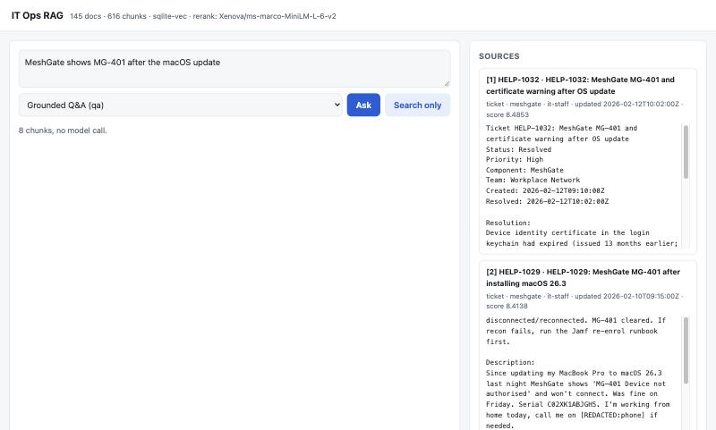
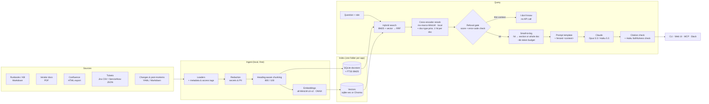
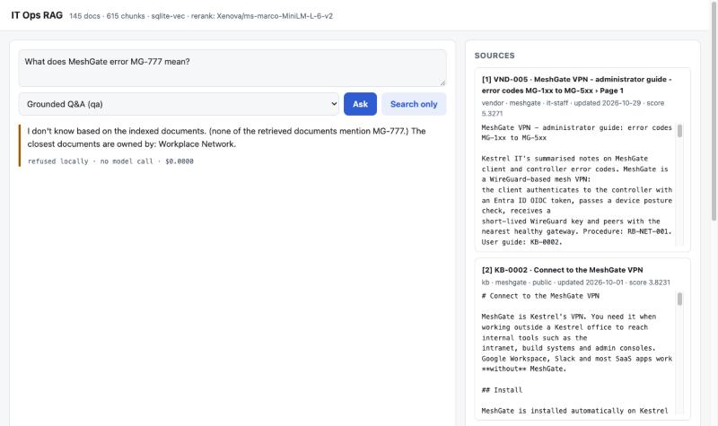

# itops-rag

**Retrieval-augmented answers for IT operations, built the way an IT systems engineer would want it:** cited
answers from runbooks, KB articles, past tickets, change records, post-mortems and vendor docs; hybrid search
that finds error codes like `AADSTS53003` and `0x80180014`; local embeddings and reranking (no per-query cost);
"I don't know" instead of guesses; and an MCP server so Claude Code and other agents can use the same knowledge.

[](https://github.com/chamu262/itops-rag/actions/workflows/ci.yml)


> **Sanitized demo of private production work.** Everything in `data/demo/` describes a made-up company,
> *Kestrel Cloud* (fictional people, tenants, hostnames, tickets and a fictional VPN called MeshGate). The engine is the
> same one I run against real IT documentation; real-use configuration and live connectors live in a private repo.



## What it is for

| Who | Typical question | Prompt |
|---|---|---|
| On-call engineer | "MeshGate shows MG-503 for everyone in Lisbon, what do I check?" | `troubleshoot` |
| Sysadmin | "Steps to re-enrol a Mac that dropped out of Jamf" | `runbook_steps` |
| Help desk (L1) | Paste a ticket and get category, priority, team, KB to send and similar tickets | `ticket_triage` |
| Help desk (L1) | Draft a plain-language reply the agent can send | `suggested_reply` |
| CAB reviewer | Paste a change plan and get the risks from past changes and incidents | `change_risk_review` |
| Incident lead | Stakeholder summary of an outage from the post-mortem | `incident_summary` |
| Team lead | Recurring lessons and open actions across post-mortems | `postmortem_lessons` |
| New joiner | "How does SSO work between Entra and Google Workspace here?" | `onboarding_qa` |
| Anyone | "Can I share a Drive folder with a contractor?" (quotes the rule) | `policy_check` |
| AI agents | `search_kb`, `get_context`, `similar_tickets` over MCP | MCP server |

There are 12 IT ops prompts, a generic `qa` prompt and a `personal` pack. See [docs/prompts.md](docs/prompts.md).

## Architecture



### How it works, visually

**[docs/how-it-works.md](docs/how-it-works.md)** walks through the whole RAG database with diagrams and real numbers
from the demo index: what each table holds, how ingest, chunking, embedding and retrieval connect, and one real
question traced through every stage.

| Layer | Strategy in one line | Diagram |
|---|---|---|
| **Database** | One SQLite file per index: documents, chunks, FTS5 keyword index, sqlite-vec vectors and a manifest, all joined by chunk rowid (Chroma optional for vectors) | [ER diagram](docs/how-it-works.md#2-what-is-in-the-database) |
| **Chunking** | Split at headings first, then 800-char chunks with 100-char overlap; tickets as core + comments; PDF headings from font size | [chunking](docs/how-it-works.md#4-chunking-strategy) |
| **Embedding** | `title > heading` + chunk text → all-MiniLM-L6-v2 (384-d, ONNX, local, free), cosine; model pinned in the manifest | [embedding](docs/how-it-works.md#5-embedding-strategy) |
| **Retrieval** | Prechecks → BM25 + vector → RRF → cross-encoder rerank + doc-type prior → 1 hit per doc → refusal gate → small-to-big expansion | [retrieval](docs/how-it-works.md#6-retrieval-strategy) · [traced example](docs/how-it-works.md#7-a-real-question-stage-by-stage) |

Try it on your own question: `python scripts/trace_query.py "your question"`. Design decisions and trade-offs are
in [docs/architecture.md](docs/architecture.md); every experiment behind the settings is in
[docs/review.md](docs/review.md).

## Quick start

```bash
git clone https://github.com/chamu262/itops-rag && cd itops-rag
python3.12 -m venv .venv && source .venv/bin/activate
pip install -e ".[web,mcp]"

itops-rag ingest data/demo/kestrel-cloud          # ~10 s, models download once (~110 MB)
itops-rag search "MG-401 after macOS update"       # free: local search, no API key
itops-rag ask "MG-401 after macOS update" --dry-run   # free: shows the exact prompt Claude would get

cp .env.example .env                               # add your ANTHROPIC_API_KEY
itops-rag ask "MeshGate shows MG-503 for everyone in Lisbon" --prompt troubleshoot
itops-rag ask "Triage this" --prompt ticket_triage --input examples/ticket.txt
itops-rag ask "Review this change" --prompt change_risk_review --input examples/change-plan.txt
itops-rag serve                                    # web UI on http://127.0.0.1:8080
```

The web UI treats every caller as `public` unless your SSO proxy vouches for a higher role: set
`ITOPS_RAG_ROLE_HEADER_SECRET`, and have the proxy send `X-ITOPS-Role` plus `X-ITOPS-Proxy-Secret` (and strip any
copies the client sent). The CLI, library and MCP server use `ITOPS_RAG_DEFAULT_ROLE`.


When the index has nothing relevant, it says so without calling the model. Here the question names an error code
that no document mentions:



Docker: `docker compose up --build`, then open http://localhost:8080. The image has the models baked in, so it runs
offline.

## Use it from Claude Code (MCP)

```bash
claude mcp add itops-rag \
  -e ITOPS_RAG_INDEX_DIR="$PWD/.itops-rag/index" \
  -e ITOPS_RAG_MODEL_CACHE_DIR="$HOME/.cache/itops-rag-models" \
  -- "$PWD/.venv/bin/itops-rag-mcp"
```

| Tool | Cost | What it returns |
|---|---|---|
| `search_kb` | free | Top chunks with doc id, section, scores, access tag |
| `get_context` | free | Retrieval and the fully rendered grounded prompt. **The calling agent answers with its own model, so there is no second API bill.** |
| `similar_tickets` | free | Past tickets like a symptom, with their resolutions |
| `get_document` | free | One full document by id |
| `list_prompts` | free | The prompt library |
| `answer_question` | tokens | Full Claude answer via the server's own key (off unless `ITOPS_RAG_MCP_ALLOW_ANSWERS=true`) |

All tools are annotated read-only. The caller's role is fixed when the server starts, never taken from a tool
argument. This fits alongside my [poc.mcp-it-tools](https://github.com/chamu262/poc.mcp-it-tools) server: that one
reads live systems, this one reads the documentation about them.

## Use it as a library (one engine, many indexes)

```python
from pathlib import Path
from itops_rag import Index, Settings

settings = Settings(index_dir=Path("~/.my-agent/rag").expanduser(), store="sqlite",
                    assistant_name="Nova", audience="one person's private notes", default_role="public")
with Index.open(settings) as ix:
    ix.ingest_path(Path("~/notes").expanduser(), prune_missing=True)
    hits = ix.search("which backup schedule did I pick?")          # free
    answer = ix.ask("When do my backups run?", prompt="notes_qa")  # cited answer from Claude
```

`pip install itops-rag` is the light base install (SQLite + ONNX, no torch, no server). Extras: `[chroma]`, `[web]`,
`[mcp]`, `[slack]`, `[langchain]`, `[all]`. Each app keeps its own index folder and prompt pack. The engine is shared;
the data never is. Full example: [examples/library_usage.py](examples/library_usage.py).

## Retrieval quality

Measured offline (no API key) on the 66-question golden set ([eval/](eval/)): 55 answerable questions across all
three roles, including 16 deliberately hard paraphrases, plus 11 that should be refused, 5 of them near-misses
("Okta SAML rotation", "MG-777"). Each question is searched exactly the way `ask()` searches it (its prompt
template's doc types and top-k), k = 4. **Primary** means the one document that should answer it (the runbook,
KB article or standard), not just any related ticket. Reproduce with `itops-rag eval`.

| Mode | hit@4 | MRR | primary hit@4 | primary MRR | recall@4 | ticket share | refusal accuracy | access leaks |
|---|---|---|---|---|---|---|---|---|
| vector | 0.93 | 0.83 | 0.89 | 0.72 | 0.68 | 0.18 | – | 0 |
| keyword (BM25) | 0.96 | 0.79 | 0.84 | 0.69 | 0.69 | 0.21 | – | 0 |
| hybrid (RRF) | 0.94 | 0.84 | 0.87 | 0.73 | 0.71 | 0.22 | – | 0 |
| **hybrid + rerank** | **0.98** | **0.90** | **0.98** | **0.84** | **0.73** | **0.10** | **1.00** | **0** |

What moved the numbers, over two calibration rounds (the [review](docs/review.md) has every experiment, including
the ones that didn't help). Round 2 used a **dev/test split**: settings were chosen on 46 dev questions, and the 20
held-out test questions were only reported (test: primary hit 1.00, primary MRR 0.86, refusal accuracy 1.00).

- **Doc-type prior and one hit per document.** In this corpus 82 of 145 documents are tickets, and they used to
  crowd runbooks out of the top 4. Adding +2 to the rerank score of authoritative doc types (for ordering only)
  raised primary hit@4 from 0.93 to 0.98 and primary MRR from 0.80 to 0.85.
- **Free refusals now catch all 11 unanswerable questions**, with no false refusals. They come from three checks
  that cost nothing: a rerank-score threshold, error codes no retrieved document mentions (MG-777), and IT products
  no visible document mentions (Okta, Chromebook, Linux).
- **The candidate pool stays at 30.** Cutting it to 20 looked free on the golden set but dropped the Autopilot runbook
  for a wordier phrasing of the same question (found by tracing it with `scripts/trace_query.py`). That phrasing is
  now a regression question, and pool 20 loses on it.
- **Hybrid plus rerank beats either half.** Vector search misses error-code questions, and keyword search misses
  paraphrases. (Without the reranker, hybrid alone is now slightly weaker than vector alone on primary hit, because
  ticket comments are their own chunks. The default path always reranks.)
- **Kept as is, after measuring alternatives:**
  - the embedding model: bge-small, arctic-embed, nomic and bge-base were no better after reranking;
  - the reranker: ms-marco-L12 was worse on dev at 2× latency, and bge-reranker-base was slower and worse;
  - chunking: merging small sections, and table rows as chunks (an opt-in setting), were mixed or didn't hold up on
    held-out questions.
- **Built, waiting on an API key to measure:** doc2query enrichment (`ITOPS_RAG_DOC2QUERY=true`, cached Haiku
  questions per chunk), query rewriting, and the answer-level eval.

Caveat: the questions were written knowing the corpus. Treat these as regression numbers, not a benchmark. CI fails
if primary hit, MRR or refusal accuracy drop (see `eval-gate` in the workflow). Re-run the experiments with
`python scripts/calibrate.py`.

## Safety and cost controls

| Control | How |
|---|---|
| Citations required | Every claim cites `[n]`. Citations are checked against the chunks actually supplied; uncited or invalid citations raise warnings. |
| "I don't know" | If the best rerank score is below a threshold, it refuses **locally, with no API call**, and names the owning team of the nearest docs. |
| Retrieved text is data | Chunks are fenced in `<context>`, tag-like text is neutralised, injection patterns are flagged `suspicious="true"`, and the system prompt says to ignore and report them. Tested with planted attacks in `data/demo/kestrel-cloud/adversarial/`. |
| Redaction at ingest | AWS, GitHub, Slack, Anthropic, Azure and Google keys, `sk-`/`pk-` keys, JWTs, Bearer/Basic auth headers, private keys (even truncated ones), `name = value` secrets (`DB_PASSWORD`, `aws_secret_access_key`, quoted values), emails and phone numbers are masked before embedding, plus IPs in tickets. People fields are dropped from ticket exports. A test ingests the adversarial fixtures and asserts that no planted secret survives. |
| Access tags | `public` < `it-staff` < `security` per document, enforced inside both the keyword and the vector query. Documents with no tag default to `it-staff`, not `public`. The web UI is `public` unless a proxy-verified role header says otherwise. |
| Cost | Embeddings, search, rerank, refusals (score, error-code and product checks) and eval are local and free. Haiku 5.5 runs the cheap steps (triage, policy checks, the faithfulness check, under $0.001), and every call is logged with its cost against a monthly budget cap that blocks calls. Unknown or fallback models are charged at the highest listed price, so the cap errs on the safe side. Prompt caching is wired but rarely pays here: the system prompt (~330 tokens) is under the 512-token minimum, and every question has different context. |
| Model safety | Server-side fallbacks (`fallbacks: "default"`) are on for Opus, so a safety-classifier decline is retried in the same call. Turn it off with `ITOPS_RAG_SERVER_FALLBACKS=false`. |

Known limits: regexes can't find personal names in free text (loaders drop known people fields instead), and a
determined attacker can phrase an injection the heuristics miss. The fencing and system rules still apply, but treat
indexed content as untrusted.

## Repository layout

| Path | What's there |
|---|---|
| [`src/itops_rag/core/`](src/itops_rag/core/) | Engine: models, chunking, redaction, embeddings, rerank, retriever, context fencing, generation, costs, `Index` |
| [`src/itops_rag/stores/`](src/itops_rag/stores/) | SQLite docstore + FTS5, sqlite-vec / numpy / Chroma vector stores |
| [`src/itops_rag/loaders/`](src/itops_rag/loaders/) | Markdown, PDF, Confluence HTML, ticket CSV/JSON, YAML records |
| [`src/itops_rag/prompts/`](src/itops_rag/prompts/) | Grounding system prompt and YAML prompt packs |
| [`src/itops_rag/interfaces/`](src/itops_rag/interfaces/) | CLI, web UI + API, MCP server, Slack stub |
| [`src/itops_rag/integrations/`](src/itops_rag/integrations/) | LangChain retriever adapter |
| [`data/demo/`](data/demo/) | The fictional Kestrel Cloud corpus (145 documents) |
| [`eval/`](eval/) | Golden set and baseline |
| [`examples/`](examples/) | Original LangChain pipeline, library usage, MCP config, sample ticket and change plan |
| [`docs/`](docs/) | Architecture, prompt library, operations guide, decision records |
| [`deploy/`](deploy/) | Slack app manifest, Cloud Run notes |
| [`tests/`](tests/) | pytest suite (offline: no models, no API key) |

## Development

```bash
pip install -e ".[all]" --group dev
pytest                       # 86 tests, offline
ruff check . && ruff format --check . && mypy
itops-rag eval --baseline eval/baseline.json
```

## Licence

MIT. Built by Chamudith Amarasinghe. The fictional demo data may be reused freely.
