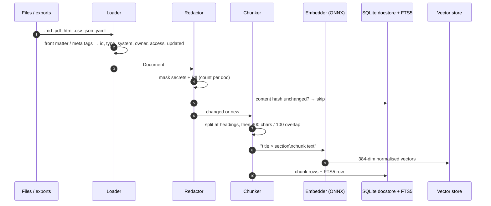
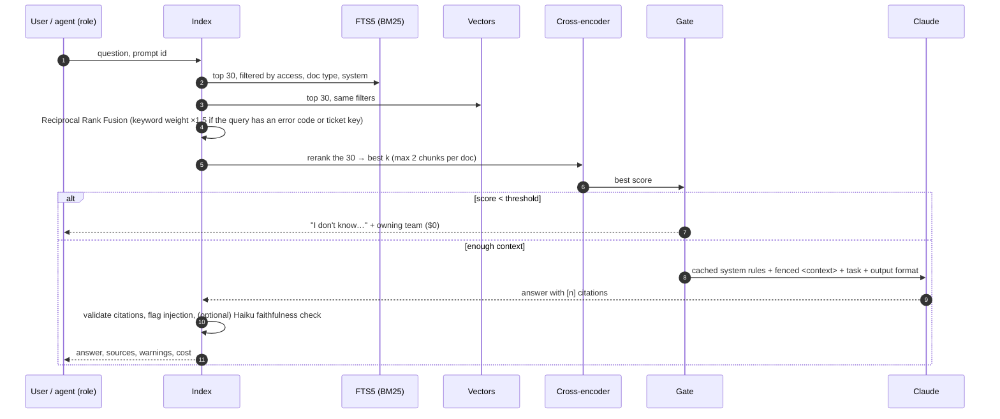

# Architecture

## The two paths

**Ingest** runs whenever docs change (a manual run, CI, or a scheduled job). Everything here is local and costs
nothing per document.

**Query** runs per question. Only the last step costs money, and only when retrieval found something worth
answering from.

## Components

| Module | Responsibility | Swappable? |
|---|---|---|
| `loaders/*` | One function per source type: `(path, root) -> list[Document]` | Add a file and register the extension |
| `core/redact.py` | Regex masking at ingest, with a per-document report | Add patterns; choose kinds per document |
| `core/chunking.py` | Heading-aware recursive splitter | Size and overlap are settings |
| `core/embeddings.py` | `Embedder` protocol; fastembed (ONNX) and a hashing test double | Any model fastembed supports |
| `stores/docstore.py` | Documents, chunks, FTS5, manifest, filters | Always SQLite (by design) |
| `stores/vectors.py` | `VectorStore` protocol: sqlite-vec, numpy fallback, Chroma | Add Qdrant or pgvector behind the same 3 methods |
| `core/retriever.py` | Hybrid search, RRF, rerank, diversity cap | Modes: vector, keyword, hybrid, hybrid_rerank |
| `core/context.py` | Fencing, injection heuristics, citation parsing | – |
| `core/generate.py` | Gate, Claude call, citation validation, verify, rewrite | Model per tier; fallbacks on/off |
| `core/costs.py` | Prices, JSONL ledger, monthly cap | – |
| `prompts/` | System rules and YAML templates | Drop YAML into `ITOPS_RAG_PROMPT_DIRS` |
| `core/index.py` | The facade apps use | – |

## Design decisions

The short version is below. The longer records are in [adr/](adr/).

1. **Keyword search lives in SQLite FTS5, whatever the vector store.** Chroma has no BM25. Keeping keyword
   search, metadata and access filters in one SQLite file means the vector store is a plug-in, and the access
   filter runs in the same query as the search, not afterwards in Python.
2. **RRF, not score blending.** BM25 scores and cosine similarities aren't on the same scale. RRF only uses ranks,
   so it needs no tuning per corpus. Queries that contain an exact identifier boost the keyword list.
3. **A cross-encoder reranker, on by default.** About 200 ms per query on a laptop CPU, $0, and the biggest single
   precision gain. It also provides the score the refusal gate uses.
4. **Refuse before the model, not only in the prompt.** The prompt still says "I don't know", but the gate stops
   obviously thin context from costing anything, and it makes refusals testable offline.
5. **Redact at ingest, not at answer time.** If a secret never reaches the index, it can't leak through any
   interface, including `search_kb` over MCP.
6. **Role is set by the deployment, not the caller.** The web UI reads a header from a trusted proxy, the MCP server
   uses its start-up setting, and the Slack bot maps channels. No tool argument can raise access.
7. **One engine, many indexes.** The manifest pins the embedding model, dimension and store. Opening an index with a
   different model fails loudly instead of returning nonsense.
8. **`get_context` over MCP.** An agent that already runs on Claude gets grounded, fenced context and answers it
   itself. That is the cheapest way for agents to use the index.

## Scaling notes

| Corpus size | What to change |
|---|---|
| Under ~50k chunks | Defaults. sqlite-vec brute-force KNN takes a few ms. |
| 50k–1M chunks | `store=chroma` (HNSW), or Qdrant/pgvector behind `VectorStore` |
| Many concurrent users | Run the web app behind gunicorn/uvicorn workers. The docstore uses SQLite WAL, with one writer (the ingest job). |
| Non-English docs | `embed_model=sentence-transformers/paraphrase-multilingual-MiniLM-L12-v2`, and `--rebuild` |
