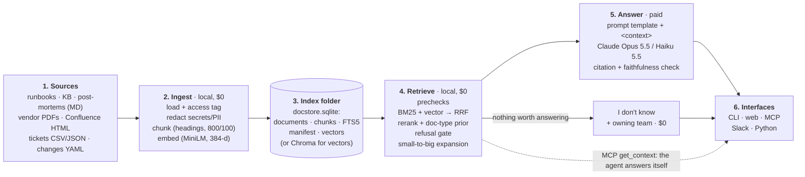
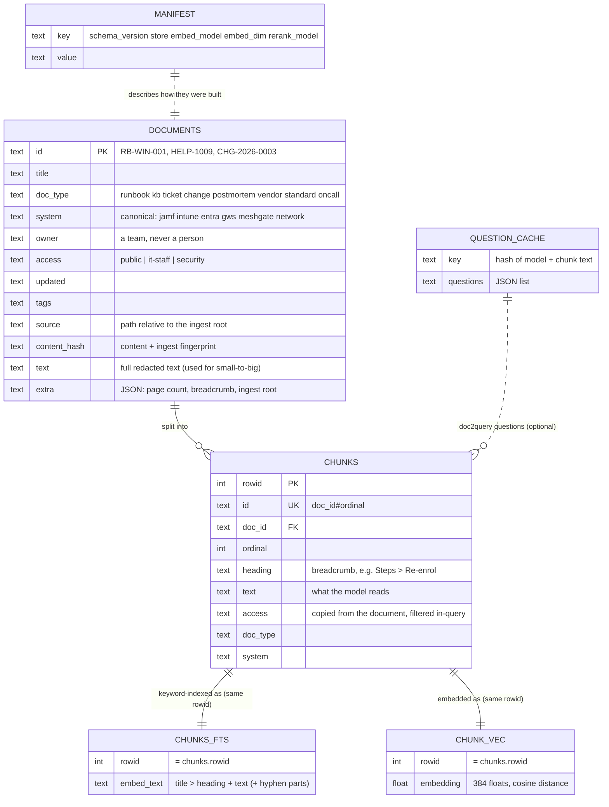
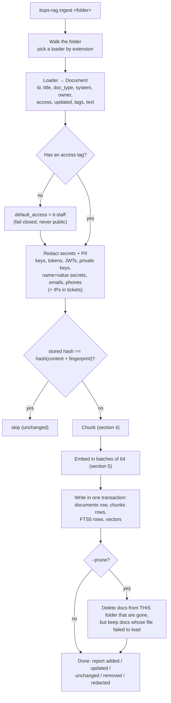
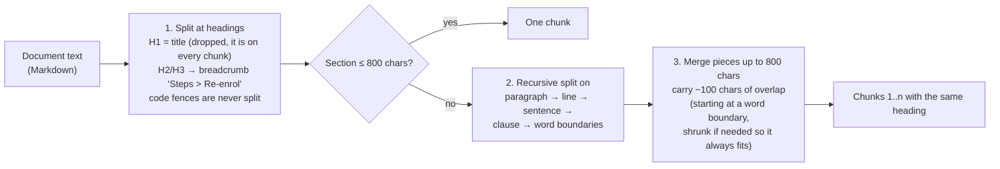
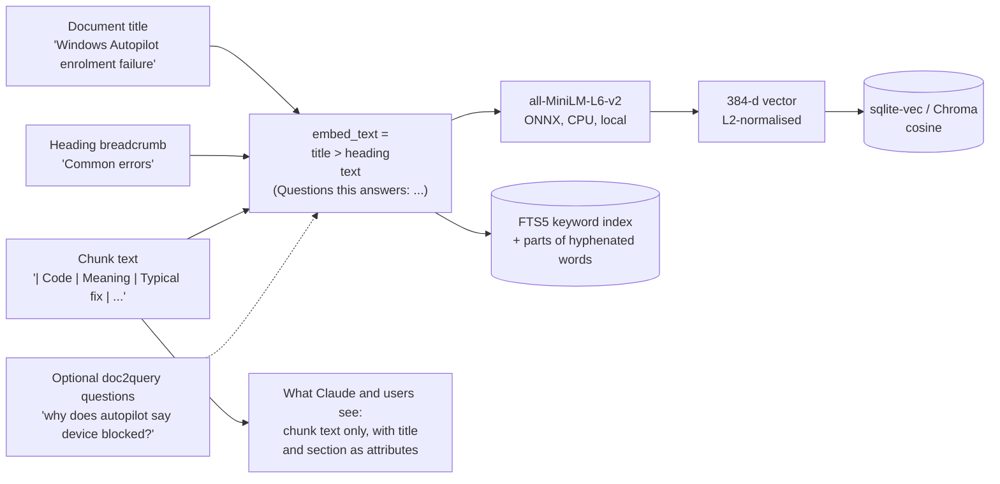
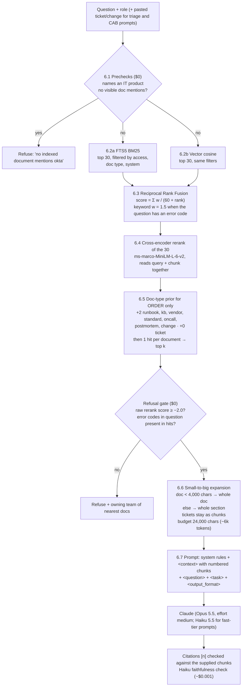
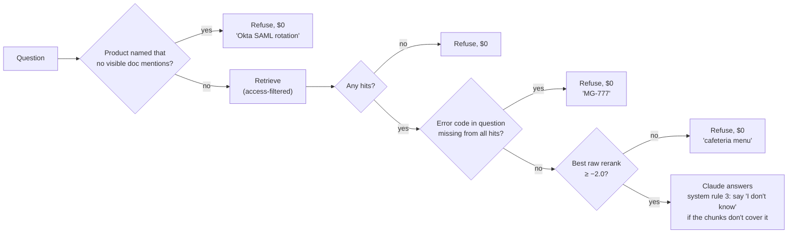

# How it works: the RAG database, chunking, embeddings and retrieval

This page walks through the whole system with diagrams and real data from the demo index. Every number
comes from the Kestrel Cloud corpus and can be reproduced:

- `itops-rag stats` shows what's in the index.
- `python scripts/trace_query.py "<question>"` follows one question through every stage.
- `python scripts/calibrate.py` re-runs the experiments behind the settings.

**Contents**
1. [The whole system on one page](#1-the-whole-system-on-one-page)
2. [What is in the database](#2-what-is-in-the-database)
3. [Ingest: from files to rows](#3-ingest-from-files-to-rows)
4. [Chunking strategy](#4-chunking-strategy)
5. [Embedding strategy](#5-embedding-strategy)
6. [Retrieval strategy](#6-retrieval-strategy)
7. [A real question, stage by stage](#7-a-real-question-stage-by-stage)
8. [Refusals and access control](#8-refusals-and-access-control)
9. [Every knob, with what it measured](#9-every-knob-with-what-it-measured)

---

## 1. The whole system on one page



Everything left of the "Answer" box runs on your machine at no per-question cost: loading, redaction, chunking,
embeddings, keyword search, vector search, reranking and the refusal checks. Claude is called once per answered
question, and only when retrieval found something worth answering from. Agents connected over MCP can skip that
call too: `get_context` returns the finished prompt, and the agent answers with its own model.

---

## 2. What is in the database

One index is one folder. With the default SQLite store, everything is in a single file, `docstore.sqlite`. With
the Chroma store, the vectors move to a `chroma/` folder beside it, and everything else stays in SQLite.



**What the demo index holds** (`itops-rag stats`):

| | |
|---|---|
| Documents | 145: 82 tickets, 17 KB, 16 runbooks, 10 changes, 6 standards, 5 vendor PDFs, 5 on-call, 4 post-mortems |
| Chunks | 696, average 324 characters (13 to 800) |
| Access | 125 it-staff · 18 public · 2 security |
| Vectors | 696 × 384 floats, sqlite-vec, cosine |
| Manifest | `embed_model = sentence-transformers/all-MiniLM-L6-v2`, `embed_dim = 384`, `rerank_model = Xenova/ms-marco-MiniLM-L-6-v2`, `store = sqlite` |
| Size on disk | about 3 MB |

**Why this shape**
- **Keyword search, metadata and access filters always live in SQLite**, whichever vector store you pick. Chroma
  has no BM25, so keeping FTS5 here makes the vector store a plug-in. sqlite-vec, Chroma and the numpy fallback
  all implement the same three methods.
- **The same `rowid` ties a chunk to its keyword row and its vector**, so a delete or update removes all three
  together.
- **The manifest pins the embedding model, dimension, store and reranker.** Opening an index with a different
  embedding model fails loudly instead of quietly returning nonsense.
- **`content_hash` includes an ingest fingerprint** (chunker version and options, redaction version). Unchanged
  documents are skipped on re-ingest, but changing a setting re-processes everything.

---

## 3. Ingest: from files to rows



On the demo corpus, a full ingest of 145 documents takes about 10 seconds on a laptop CPU. A re-ingest with nothing
changed takes under a second (0.86 s measured), because every document is skipped by hash.

---

## 4. Chunking strategy

The goal is chunks that are **small enough to match precisely** (one procedure, one error code, one ticket) but
**never cut across a boundary that changes meaning**, such as two different procedures in one chunk. Section 6
explains how the model still gets the full surrounding text.

### 4.1 The general rule: split on headings first, then on size



**A real runbook, RB-WIN-001 "Windows Autopilot enrolment failure":**

| # | Heading | Chars | Why it is its own chunk |
|---|---|---|---|
| 0 | Purpose | 189 | own section |
| 1 | Scope | 130 | own section |
| 2 | Prerequisites | 301 | own section |
| 3 | Common errors | 670 | the error-code table, matched by "0x80180014" |
| 4 | Steps | 694 | Steps is 1,700+ chars, so split… |
| 5 | Steps | 760 | …into three chunks… |
| 6 | Steps | 295 | …with ~100 chars of overlap between them |
| 7 | Verification | 185 | own section |
| 8 | Rollback | 89 | own section |
| 9 | Escalation | 125 | own section |

The "Common errors" chunk says the fix is in step 3, but step 3 lives in chunk 4. That is why retrieval expands hits
before Claude sees them (section 6.6).

### 4.2 Per source type

| Source | How it is split | Real example |
|---|---|---|
| **Runbooks, KB, post-mortems, on-call** (Markdown) | Headings first, then size (4.1) | RB-WIN-001 → 10 chunks |
| **Tickets** (CSV/JSON) | **Core chunk(s)**: summary, status, resolution, description. **Comment chunk(s)** apart. People fields (reporter, assignee) are dropped at load. | HELP-1009 → core 666 + 263 chars, comments 228 chars |
| **Vendor PDFs** | Headings recovered from **font size** (lines ≥ 1.15× the body size), with the page kept: "MG-4xx authentication (p. 1)". Falls back to "Page N" sections. | VND-005 → "Code families (p. 1)", "MG-1xx client (p. 1)", … |
| **Confluence HTML** | Navigation, breadcrumb and footer stripped; HTML headings, lists and tables converted to Markdown, then 4.1 | CF-005 → "Severity definitions", … |
| **Change records** (YAML) | Known fields become sections: Summary, Impact, Plan (numbered), Backout, Validation, Outcome, Lessons. Unknown fields are kept as text. | CHG-2026-0003 → Plan / Backout / Outcome … |

### 4.3 Measured alternatives (not defaults)

| Option | What it does | Result | Status |
|---|---|---|---|
| `min_section_chars` | Merges sections under N chars into a neighbour | 657 → 416 chunks. Recall +0.03 but primary MRR −0.01 to −0.02 on dev | opt-in |
| `table_rows` | Each Markdown table row becomes a chunk, with the header repeated | Fixed "who is on call for Jamf?" on dev, broke one held-out question | opt-in |
| Chunk size 500 / 1200 | | 500 was worse; 1200 neutral | 800 kept |
| Contextual header `[doc_type, system, tags]` on every chunk | | Mixed: dev −0.02, test +0.06 | not used |

---

## 5. Embedding strategy

### 5.1 What gets embedded is not exactly what the model reads



Real `embed_text` for chunk RB-WIN-001#3:

```text
Windows Autopilot enrolment failure > Common errors
| Code | Meaning at Kestrel | Typical fix |
|---|---|---|
| `0x80180014` | Device blocked from MDM enrolment. Usually the device was deleted from Intune while the Autop…
```

**Why the title and heading go on top:** a chunk that only says "Run step 3 again" means nothing on its own.
With "Windows Autopilot enrolment failure > Steps" in front of it, both the vector and the keyword index know what
it is about.

### 5.2 The model and why it was kept

| | |
|---|---|
| Model | `sentence-transformers/all-MiniLM-L6-v2`: 384 dimensions, run through ONNX Runtime by fastembed. No torch, no API key, no text leaves the machine. |
| Cost | Free. The demo corpus embeds in seconds; a query embeds in about 2 ms. |
| Similarity | Vectors are L2-normalised, so cosine similarity equals the dot product |
| Pinning | The model name and dimension go in the manifest, and a mismatch raises an error. Change models by re-ingesting with `--rebuild`. |

The alternatives, measured on the hard questions after reranking:

| Model | Build time | Hard primary hit | Verdict |
|---|---|---|---|
| **all-MiniLM-L6-v2** | **4.7 s** | **0.81** | **kept** |
| bge-small-en-v1.5 | 12.0 s | 0.81 | no gain, 2.5× slower |
| snowflake-arctic-embed-s | – | 0.81 | no gain |
| nomic-embed-text-v1.5 | 25.5 s | 0.75 | worse |
| bge-base-en-v1.5 | 38.3 s | 0.75 | worse, 8× slower |

The reranker (section 6.4) does the precise ordering, so the embedding model mainly needs to get the right document
into the top 30. MiniLM does that as well as the bigger models.

### 5.3 Optional: doc2query

`ITOPS_RAG_DOC2QUERY=true` makes Haiku write three questions each chunk answers, in users' own words. One call per
document is cached by chunk content, so re-ingests are free. The questions are added to `embed_text`, so they
help both keyword and vector matching, but they are never shown to the model. Tickets are skipped, because they are
already phrased as questions. The feature is built and tested, but not yet measured (it needs an API key).

---

## 6. Retrieval strategy



| Stage | What it is for | Why this choice |
|---|---|---|
| **6.1 Prechecks** | Questions about things the index can't know (Okta, Chromebook, Linux) | Their nearest neighbours (the *Entra* SAML runbook) score as high as real answers, so only a lexical check catches them. Free. |
| **6.2a BM25 (FTS5)** | Exact strings: `0x80180014`, `AADSTS53003`, `MG-401`, `HELP-1042` | Embeddings blur codes. Tokens keep hyphens (MG-401 stays one token), and hyphenated words are also indexed by their parts ("on call" finds "on-call"). |
| **6.2b Vectors** | Paraphrases: "VPN says I'm not authorised" ≈ MG-401 | Keywords miss synonyms |
| **6.3 RRF** | Merging two ranked lists whose scores aren't comparable | Uses ranks only, so nothing needs calibrating. Measured: hybrid beats either half. |
| **6.4 Rerank** | Precision: reads question and chunk *together* | Biggest single quality gain, about 230 ms on CPU, free. It also provides the score the gate uses. |
| **6.5 Doc-type prior** | 82 of 145 docs are tickets, and many near-duplicates outrank the runbook | +2 for authoritative types, for ordering only (the gate sees raw scores). Primary hit 0.93 → 0.98. |
| **1 hit per doc** | Diversity: four different documents beat four chunks of one | Expansion brings the rest of the document back |
| **Gate** | No API call when there's nothing to answer from | Answerable questions score ≥ −1.23; off-topic ones −4.6 to −11. Near-misses ("Okta SAML") score up to 7.8, which is why the product check exists. |
| **6.6 Small-to-big** | Chunks are ~324 chars, but procedures span chunks | Match small, read big. The context grows from ~600 to ~3,000 tokens of complete sections. |
| **6.7 Prompt** | Grounding: answer only from context, cite [n], treat context as data | One system prompt shared by every template, so no template can weaken it |

**Access control is inside the queries, not a post-filter.** `access IN (...)` is part of the FTS5 SQL and the
Chroma `where` clause. For sqlite-vec, the KNN over-fetches and filters by rowid in SQL, widening until it has
enough allowed results. A chunk the caller can't see never reaches the reranker, the prompt or the logs.

---

## 7. A real question, stage by stage

Output of `python scripts/trace_query.py "Autopilot fails with 0x80180014 on a new laptop" --prompt troubleshoot`
(role it-staff, k = 6):

**Prechecks:** no unknown product. Error code found: `0x80180014`.

| Stage | Top results |
|---|---|
| BM25 (top 5 of 30) | HELP-1009 core 17.14 · HELP-1009 core 15.52 · HELP-1009 comments 15.45 · INC0010006 14.26 · HELP-1055 14.01 |
| Vector (top 5 of 30) | HELP-1009 comments 0.864 · HELP-1009 core 0.759 · INC0010006 comments 0.706 · HELP-1009 core 0.691 · HELP-1019 0.640 |
| RRF (keyword weight 1.5 because of the code) | HELP-1009 0.0407 · HELP-1009 0.0402 · HELP-1009 0.0398 · HELP-1019 0.0378 · INC0010006 0.0376 |

Every first-stage list is all tickets: they repeat the exact error string. Then the reranker and the prior:

| # | Document | Raw rerank | Prior | Final |
|---|---|---|---|---|
| 1 | HELP-1009 (ticket) | 10.06 | +0 | 10.06 |
| 2 | INC0010006 (ticket) | 8.36 | +0 | 8.36 |
| 3 | OC-005 known issues (on-call) | 5.54 | +2 | 7.54 |
| 4 | **RB-WIN-001 runbook** | 5.03 | **+2** | **7.03** |
| 5 | HELP-1055 (ticket) | 6.93 | +0 | 6.93 |
| 6 | HELP-1019 (ticket) | 6.62 | +0 | 6.62 |

Without the prior, the runbook (5.03) would rank below every matching ticket. With it, it makes the context next to
the two tickets that match most exactly.

**Gate:** passes (best raw score 10.06 ≥ −2.0, and `0x80180014` appears in the hits).

**Expansion:**

| Hit | Matched chunk | Sent to Claude |
|---|---|---|
| OC-005 | 438 chars | 3,891: whole document (under 4,000) |
| RB-WIN-001 | 670 chars ("Common errors") | 3,419: whole document, so the steps the error table points to come with it |
| Tickets | 600–700 chars | unchanged |

**Prompt:** about 11,800 characters (~2,950 tokens) of context and task, plus the 1,345-character system rules.

This trace also caught a mistake. With a candidate pool of 20 (the 0.2.0 default), RB-WIN-001 never reached the
reranker for this phrasing. The pool went back to 30 in 0.2.1, and this question is now in the eval.

---

## 8. Refusals and access control



Eval result: all 11 unanswerable questions are refused by the free checks, and none of the 55 answerable ones are
refused by mistake.

| Who is asking | Role they get | Sees |
|---|---|---|
| CLI, library, MCP server | `ITOPS_RAG_DEFAULT_ROLE`, fixed per process | that role and below |
| Web UI, no verified header | `public` | public only |
| Web UI via your SSO proxy | `X-ITOPS-Role` + `X-ITOPS-Proxy-Secret` | the role the proxy vouches for |
| Slack bot | mapped per channel (`public` by default) | that role and below |

`public` < `it-staff` < `security`. A document without a tag is `it-staff`, never `public`.

---

## 9. Every knob, with what it measured

| Setting (`ITOPS_RAG_…`) | Default | What it changes | Measured effect |
|---|---|---|---|
| `CHUNK_SIZE` / `CHUNK_OVERLAP` | 800 / 100 | Max chunk size and carry-over | 500 worse, 1200 neutral |
| `SPLIT_TICKET_COMMENTS` | true | Ticket comments in their own chunks | Neutral on retrieval, cleaner context |
| `MIN_SECTION_CHARS` | 0 (off) | Merge small sections | Mixed |
| `TABLE_ROWS` | false | One chunk per table row | +1 dev, −1 test question |
| `EMBED_MODEL` | all-MiniLM-L6-v2 | Embedding model (needs `--rebuild`) | Bigger models no better after rerank |
| `DOC2QUERY` | false | Haiku-written questions per chunk | Not measured yet (needs API key) |
| `MODE` | hybrid_rerank | `vector` / `keyword` / `hybrid` / `hybrid_rerank` | Hybrid + rerank best |
| `CANDIDATES` | 30 | Rerank pool size | 20 dropped a runbook for wordy questions |
| `POOL_CHUNKS_PER_DOC` | 0 (off) | Cap chunks per doc in the pool | Hurt MRR |
| `RERANK_MODEL` | ms-marco-MiniLM-L-6-v2 | Cross-encoder | L12 worse and 2× slower; jina-turbo promising but needs its own threshold |
| `DOC_TYPE_BOOST` | +2 non-ticket | Ordering prior | Primary hit 0.93 → 0.98 |
| `MAX_CHUNKS_PER_DOC` | 1 | Hits per document | Recall up with expansion |
| `MIN_RERANK_SCORE` | −2.0 | Refusal threshold | Answerable ≥ −1.23, off-topic ≤ −4.6 |
| `PRODUCT_GATE` | true | Refuse unknown products | Refusal accuracy 0.95 → 1.00 |
| `CONTEXT_CHAR_BUDGET` / `EXPAND_WHOLE_DOC_CHARS` | 24000 / 4000 | Small-to-big limits | ~3k tokens of context per answer |
| `ANSWER_MODEL` / `FAST_MODEL` / `EFFORT` | Opus 5.5 / Haiku 5.5 / medium | Generation | – |
| `VERIFY_ANSWERS` | true | Haiku faithfulness check | about $0.001 per answer |

How to change one safely: edit it, run `itops-rag ingest` (chunking and embedding settings re-process automatically),
then `itops-rag eval --split dev`. Keep it only if dev improves, then read `--split test` once.
